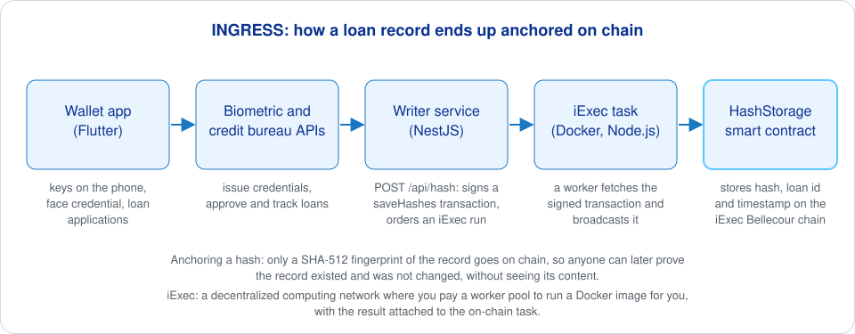

# INGRESS project site

The website of INGRESS, an Iriscan project from the EU NGI ONTOCHAIN program. INGRESS gives people without a banking history a way to build one: a biometric credential issued from a face photo, a wallet app to apply for microloans, and loan records whose hashes are anchored on a blockchain so lenders can trust them. The site explains why biometrics and digital credit histories matter for financial inclusion, and holds the user guides for the three parts of the system. It is a Jekyll site with the `minima` theme, served from a Caddy container.



Anchoring a hash means writing only a fingerprint of a record (here SHA-512) to the chain: anyone can later check that a record existed at a given time and was not altered, while the record itself stays private. iExec is a decentralized computing network: you pay a worker pool to run a Docker image for you, and the result is tied to an on-chain task.

## What is on the site

- `index.markdown`: the introduction on microlending, biometrics against fraud, and digital credit histories.
- `about.markdown`: what INGRESS does and why.
- `wallet.markdown`: the Mobile Wallet guide, from key generation to credentials, loan applications and loans, with screenshots in `wallet/`.
- `bb.markdown`: the Biometric Bureau back office, where staff see registered users and their biometrics and export database dumps; screenshots in `biometric-bureau/`.
- `cb.markdown`: the Credit Bureau back office, where staff manage loan offers, confirm applications by taking the applicant's biometrics on a webcam, and manage loans; screenshots in `credit-bureau/`.

## How to run

You need Ruby with Bundler. The `Gemfile` pins Jekyll and the theme.

```sh
bundle install
bundle exec jekyll serve      # http://localhost:4000
```

For the container, build the static site first, then the image. The `Dockerfile` copies `_site/` into a Caddy 2 image that listens on port 80 and maps clean URLs to `.html` files:

```sh
bundle exec jekyll build
docker build -t ingress-site .
docker run -p 8080:80 ingress-site
```

## Related repositories

- [ontochain-digital-wallet](https://github.com/biometric-technologies/ontochain-digital-wallet): the Flutter wallet the guide describes.
- [ontochain-iexec-writer](https://github.com/biometric-technologies/ontochain-iexec-writer), [ontochain-iexec-task](https://github.com/biometric-technologies/ontochain-iexec-task), [ontochain-iexec-smartcontract](https://github.com/biometric-technologies/ontochain-iexec-smartcontract): how loan-record hashes reach the chain.

## License

License: not yet specified.

## Contact

info@iriscan.net, https://www.iriscan.com
